<div align="center">

<!-- Profile Hero Banner -->
  

  <a href="https://github.com/DenverCoder1/readme-typing-svg">
    
  </a>

</div>

<p align="center">
  Learning by building practical projects and strengthening my software development fundamentals.
</p>

---

## 🚀 What I'm Working On

- 🐍 Python & Object-Oriented Programming
- 🗄️ MySQL & Database Design
- 🌐 Web Development
- 🔧 Git & GitHub
- 🧠 Programming Fundamentals

---

## 🛠️ Tech Stack

### Languages


![Rust]

### Tools


---

## 📂 Projects

### 🐍 Python & OOP
Projects and exercises created while learning Object-Oriented Programming with Python.

### 🗄️ Database Systems
Projects involving ERD, SQL, CRUD, relational database design, and MySQL.

### 🌐 Web Development
Web projects exploring frontend and database integration.

---

## 📚 Currently Learning

```text
Computer Science
├── Programming Fundamentals
├── Object-Oriented Programming
├── Database Systems
└── Web Development

Development
├── Python
├── SQL / MySQL
├── Git / GitHub
└── JavaScript
```

---

## 🎯 Goals

- Build real-world software projects
- Strengthen programming fundamentals
- Learn modern web development
- Create useful and maintainable applications
- Build a strong developer portfolio
- Contribute to collaborative projects

---

## 🕹️ Galaga Contribution Graph

<picture>
  <source media="(prefers-color-scheme: dark)" srcset="https://raw.githubusercontent.com/herdiansyahdp/herdiansyahdp/output/galaga-contribution-graph-dark.svg">
  <source media="(prefers-color-scheme: light)" srcset="https://raw.githubusercontent.com/herdiansyahdp/herdiansyahdp/output/galaga-contribution-graph.svg">
  
</picture>


---

## 🔥 GitHub Commit Streak

[](https://git.io/streak-stats)

## 📊 GitHub Stats





---

## 📫 Connect With Me

[](https://github.com/herdiansyahdp)
[](https://www.linkedin.com/in/Herdiansyah%20Dwi%20Putra)
[](https://www.instagram.com/eldks_27)

---

> **Build. Learn. Improve. Repeat. 🚀**
